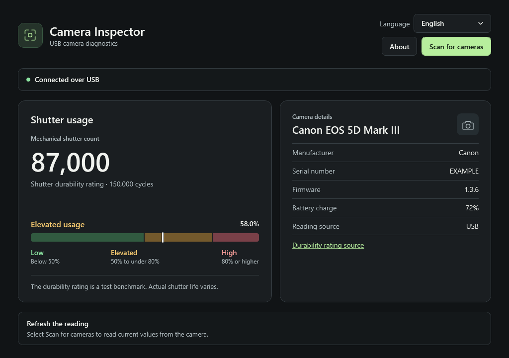

# Camera Inspector

A utility for reading camera details over USB or compatible Wi-Fi connections and checking counters in original Nikon, Fujifilm, Sony, and Pentax photos. It compares available mechanical counts with the manufacturer’s published durability ratings.

## Download

Download Camera Inspector from [GitHub Releases](https://github.com/notuxius/camera-inspector/releases). Tauri builds use the system webview and run without .NET.

| Platform | Download |
| --- | --- |
| Windows x64 | Run the Windows installer. It installs Microsoft Edge WebView2 if needed. |
| macOS 13 or later on Apple Silicon | Open the disk image and drag **Camera Inspector** into Applications. |

Release notes list the requirements for older downloads.

## Example dashboard



## Use the app

Select **Open original photo** and choose a recent, unedited Nikon NEF or JPEG, Fujifilm RAF, Sony ARW or JPEG, or Pentax PEF or DNG. The reading comes from metadata saved when the picture was taken. To read camera details over USB, follow these steps.

1. Connect the camera to your computer with a USB data cable and switch it on.
2. If the camera asks for a USB mode, choose photo import, remote control, or PC connection.
3. Open Camera Inspector and select **Scan for cameras**. Close Canon EOS Utility if it is holding the connection.

On macOS, allow camera access if prompted. Allow local network access when the app first scans over Wi-Fi.

On the Fujifilm X-E5, select **USB CARD READER** under **Network/USB Setting** → **Connection Mode**. [Fujifilm X-E5 manual](https://app.fujifilm-dsc.com/en/manual/x-e5/connections/network_usb_menu/)

### Scan over Wi-Fi

1. On a compatible Canon EOS camera, open **Connect to EOS Utility** and start pairing or reconnect to the saved Camera Inspector connection. Close EOS Utility on the computer.
2. Join the same local network on both devices, or connect the computer to the camera’s Wi-Fi network.
3. In Camera Inspector, select **Scan over Wi-Fi**. Pick the discovered camera address or enter its IPv4 address, then select **Connect**. Confirm pairing on the camera if prompted. [Canon EOS R8 pairing guide](https://cam.start.canon/en/C013/manual/html/UG-07_Network_0050.html)

Automatic discovery looks for Canon EOS cameras advertising PC pairing. Direct IPv4 entry uses standard PTP/IP on port 15740 and can read basic metadata from other cameras that expose this protocol. Battery, Canon shutter count, and Canon error status depend on what the camera returns in that wireless mode. The USB diagnostic monitor and storage checks remain available through a USB scan. See the [Wi-Fi scanning models](#wi-fi-scanning-models) for specific models and their validation status. [Canon pairing and PTP/IP packet trace](https://julianschroden.com/post/2023-05-10-pairing-and-initializing-a-ptp-ip-connection-with-a-canon-eos-camera/)

### Dashboard

The **Language** and **Theme** settings both default to **System**. Camera Inspector follows the system display language and app color settings, using English if the display language is unavailable. You can also choose a specific language or select **Light** or **Dark** and Camera Inspector will remember your choices. The **About** section in Settings shows the installed version and links to supported cameras and the latest release.

Camera Inspector restores the dashboard window's size and position when you reopen it.

Camera Inspector displays the model, firmware, serial number, battery charge, and shutter count when the source supplies them. USB discovery uses Windows Portable Devices on Windows and ImageCaptureCore on macOS. The app displays uncertain counters as reported and leaves the usage status gray. When the reading supplies a range or an uncertain counter, you can enter an exact mechanical count from a service report if a manufacturer rating is available.

The camera outline uses the shutter usage palette. It starts neutral, turns green when a read succeeds, yellow when a successful read reports an active camera error, and red when the read fails.

**Camera issues** flags battery charge at 20% or below, high mechanical shutter usage, and decreases recorded in shutter history. When a Canon EOS scan receives an active error value, the app looks up its decimal value in Canon’s published on-camera error descriptions. The dashboard labels these as possible matches because the available USB traces only confirm the zero value. It also shows the original hexadecimal code. [Canon EOS error descriptions](https://asia.canon/en/support/8200669200) · [Canon EOS R USB trace](https://github.com/gphoto/libgphoto2/blob/master/camlibs/ptp2/cameras/canon-eos-r.txt)

USB scans check storage across all supported brands. The dashboard explains full and read-only volumes exposed by Windows Portable Devices. On macOS and when Windows supplies no usable storage data, the app tries read-only PTP storage queries and explains known camera responses such as unavailable, busy, or inaccessible storage. An empty storage list leaves the check inconclusive. [Windows storage properties](https://learn.microsoft.com/en-us/windows/win32/wpd_sdk/storage-properties) · [PTP responses](https://github.com/gphoto/libgphoto2/blob/master/camlibs/ptp2/ptp.h)

On bodies and USB modes that expose vendor status, the app also reads Nikon’s display error indicator, Fujifilm’s device error value, and Sony’s temperature warning. Nikon’s indicator gives no fault details, and Fujifilm values without a published interpretation are shown alongside a prompt to check the camera display. Manufacturer service logs and original-photo imports do not provide live fault information to the app. [Nikon status property](https://github.com/gphoto/libgphoto2/blob/master/camlibs/ptp2/config.c) · [Fujifilm X-T1 trace](https://github.com/malc0mn/ptp-ip/blob/master/docs/fuji_x-t1_known-properties.md) · [Sony α7 V property trace](https://github.com/gphoto/libgphoto2/blob/master/camlibs/ptp2/cameras/sony-a7m5.txt)

The dashboard shows a suggested next step under each reported issue. It asks you to confirm a possible Canon match on the camera display and to save the displayed message for support if an unknown error returns. Storage troubleshooting includes a backup step before deleting files or formatting media. [Canon EOS troubleshooting](https://asia.canon/en/support/8201509200) · [Fujifilm warning messages](https://app.fujifilm-dsc.com/en/manual/x-t5/technical_notes/warning_messages/) · [Sony warning messages](https://helpguide.sony.net/ilc/2320/v1/en/contents/t11_messages.html)

**Companion apps** appears when a live scan or original photo identifies a camera with a known app. The dashboard links to desktop downloads for your operating system and labels apps that are available only on the other platform. The download pages list OS and firmware requirements. Mobile apps have App Store and Google Play links where available. If the phone app depends on firmware that Camera Inspector cannot verify, select **Check app compatibility**.

For the Fujifilm X-E5, install **FUJIFILM XApp** from the dashboard links, pair the camera, and look for **Number of shutter movements** under **Equipment Status**. Enter that value in Camera Inspector and select **Apply count**. The dashboard labels it **Manual count** and shows the mechanical reading even without a durability rating. Select **Reset** to restore the USB or RAF reading. [Fujifilm’s explanation of the XApp counters](https://digitalcamera-support-en.fujifilm.com/digitalcameraengpcdetail?aid=000004895)

The first live scan with a serial number and shutter count saves a baseline on this computer. USB and Wi-Fi scans share history when the camera model, serial number, and Canon counter match. The dashboard shows whether the count changed and remembers the most recent decrease. History is stored in `%LOCALAPPDATA%\Camera Info\Shutter History` on Windows and `~/Library/Application Support/Camera Inspector/Shutter History` on macOS.

A decrease can also follow a shutter replacement. To investigate a change from before the first scan, compare with an earlier reading or service report for the same camera and counter. On bodies that report in thousands, a reading of `≤ 12,000` represents 11,001 through 12,000 actuations. A range can stay the same while the shutter is used. A range crossing a usage threshold leaves the zone unassigned.

## Original-photo counters

| Format | Counter |
| --- | --- |
| **Nikon NEF and JPEG** | Dedicated mechanical count where present, otherwise the camera-reported shutter count. Electronic-only Z 8, Z 9, and ZR use the reported count when available. |
| **Fujifilm RAF** | The camera’s image count, including on the X-E5 and X-T30 III. This counter may reset with a firmware update. |
| **Sony ARW and JPEG** | Mechanical count on supported bodies such as the α6700 and α7 V when the file contains that field. Other supported layouts supply a camera-reported count. On the α1 II, α7 V, and α7R VI, a photo taken with the mechanical shutter can carry the mechanical counter. |
| **Pentax PEF and DNG** | Camera-reported shutter count from the Pentax MakerNote when present. |

Photo import runs locally. The usage zone requires a mechanical count and a published durability rating. Shutter history records live counts. [Nikon metadata](https://github.com/exiftool/exiftool/blob/master/lib/Image/ExifTool/Nikon.pm) · [Nikon durability ratings](https://www.nikonimgsupport.com/eu/BV_article?articleNo=000044853&configured=1&lang=en_GB&setRedirect=true) · [Fujifilm metadata](https://github.com/exiftool/exiftool/blob/master/lib/Image/ExifTool/FujiFilm.pm) · [Sony metadata](https://github.com/exiftool/exiftool/blob/master/lib/Image/ExifTool/Sony.pm) · [Pentax metadata](https://github.com/exiftool/exiftool/blob/master/lib/Image/ExifTool/Pentax.pm)

## Canon USB support

The USB reader has shutter-count routes for 22 target EOS models and retains legacy routes for the EOS 5D Mark II and original EOS 7D. See the [brand support table](#brand-support) for the model list and current support status.

The headless checks emulate all 24 USB model routes at the shared PTP interface. They cover high counts on all three counter formats, rejected commands, session cleanup, and storage status. The diagnostic decoder uses both high bytes and the rotating low byte. A published EOS 5DS R capture for the same counter decodes to 189,052 and then 189,072 after 20 shots. An unfamiliar reply layout leaves the mechanical count unavailable. [USB product IDs](https://github.com/gphoto/libgphoto2/blob/master/camlibs/ptp2/library.c) · [EOS R capture](https://github.com/gphoto/libgphoto2/blob/master/camlibs/ptp2/cameras/canon-eos-r.txt) · [EOS R8 field tests](https://github.com/DigitalN/Open-Shutter-Count/blob/main/docs/R8-PROGRESS.md) · [5D Mark IV diagnostics](https://github.com/mvisonneau/openshuttercounter/blob/main/docs/PROTOCOL.md) · [6D Mark II captures](https://github.com/mvisonneau/openshuttercounter/pull/8) · [5DS R high-count captures](https://github.com/mvisonneau/openshuttercounter/pull/5)

The EOS 80D firmware 1.0.1 USB log lists the diagnostic commands, and a separate desktop reader reports successful 80D reads on firmware 1.0.1 through 1.0.3. Disable Wi-Fi/NFC and time-lapse movie mode before trying an 80D USB read. [80D USB protocol log](https://github.com/gphoto/libgphoto2/blob/master/camlibs/ptp2/cameras/canon-80d.txt) · [80D firmware test results](https://app.camerashuttercount.com/nb/cameras/canon-eos-80d)

## Shutter usage zones

| Zone | Share of the manufacturer’s rated cycles |
| --- | --- |
| Green · Low | Below 50% |
| Yellow · Elevated | 50% to under 80% |
| Red · High | 80% or higher |

These thresholds are app-defined. The rating measures tested shutter durability and actual service life varies. The app links to the manufacturer’s source when a rating is available.

## Build

Install the [Tauri build prerequisites](https://v2.tauri.app/start/prerequisites/) for your platform and Node.js 24. Run these commands from the repository root.

```sh
npm ci
cargo install cargo-about --version 0.9.3 --locked
npm run licenses
npm test
cargo test --locked --manifest-path src-tauri/Cargo.toml --features custom-protocol
```

Build the Windows installer with `npm run tauri -- build --bundles nsis -- --locked`. Build the macOS disk image on an Apple Silicon Mac with `npm run tauri -- build --bundles dmg -- --locked`. The packages are written under `src-tauri/target/release/bundle`.

The Windows installer and macOS app bundles include the MIT license and third-party notices in their `licenses` resources. GitHub Actions generates the dependency notices from `Cargo.lock` and verifies the installed files against the build inputs.

The GitHub Actions workflow builds and smoke-tests the Windows x64 installer and Apple Silicon disk image. Branch builds use ad-hoc macOS signing for testing. A version tag matching the app version builds the Developer ID-signed, notarized disk image using the repository secrets described in the [Tauri signing guide](https://v2.tauri.app/distribute/sign/macos/). Attach both packages to the same GitHub Release and verify the license and platform jobs on the published tag.

USB transport uses the Windows MTP extensions or ImageCaptureCore PTP commands. [Microsoft WPD MTP documentation](https://learn.microsoft.com/en-us/windows/win32/wpd_sdk/supporting-mtp-extensions) · [Apple camera API](https://developer.apple.com/documentation/imagecapturecore/iccameradevice) · [libgphoto2 property definitions](https://github.com/gphoto/libgphoto2/blob/master/camlibs/ptp2/ptp.h)

<a name="brand-support-backlog"></a>

## Brand support

USB metadata includes whichever of model, manufacturer, serial number, firmware, and battery charge the camera and operating system expose. Discovery accepts still cameras identified by Windows Portable Devices or ImageCaptureCore, allowing additional and future cameras to appear without an app update. USB mass storage and tethering modes can expose different details. All 24 Canon counter routes have emulator coverage. Camera model and firmware combinations still require physical hardware validation. [Windows device classification](https://learn.microsoft.com/windows/win32/wpd_sdk/wpd-device-types) · [Original RAW samples](https://raw.pixls.us/)

See the [backlog](BACKLOG.md) for validation and implementation plans.

| Brand and models | Current support in Camera Inspector |
| --- | --- |
| **Canon EOS:** 5D Mark II, 5D Mark III, 6D, 7D, 7D Mark II, 70D | USB mechanical shutter count via the legacy property, with single-actuation precision |
| **Canon EOS:** 5D Mark IV, 6D Mark II, 80D | USB mechanical shutter count via Canon diagnostics, with single-actuation precision |
| **Canon EOS:** 90D, 850D (Rebel T8i / Kiss X10i), M50 Mark II (Kiss M2), R, RP, R5, R5 Mark II, R6, R6 Mark II, R6 Mark III, R7, R8, R10, R50, R100 | USB mechanical shutter count via the EOS release event, reported as an upper bound in 1,000-actuation steps |
| **Other Canon examples:** EOS R1, R3, R5 C, R6 V, R8 Mark II, R50 V, PowerShot G7 X and V1 | USB metadata |
| **Nikon DSLR:** D3500, D5600, D7000, D7100, D7200, D7500, D500, D610, D750, D780, D800, D810, D850, D5, D6 | Shutter count from original NEF or JPEG photos and USB metadata |
| **Nikon Z:** Z 5, Z 5II, Z 5IIC, Z 6, Z 6II, Z 6III, Z 7, Z 7II, Z 30, Z 50, Z 50II, Z fc, Z f, Z 8, Z 9, ZR | USB metadata and a counter where present in original NEF or JPEG photos |
| **Sony Alpha:** α6700, α7C II, α7CR, α1 II, α7 V, α7R VI, FX2 | USB metadata and a mechanical count where present in original ARW or JPEG photos |
| **Other Sony Alpha examples:** α6100, α6300, α6400, α6500, α6600, α7 III, α7 IV, α7C, α7R II through V, α7S II/III, α1, α9, α9 II, ZV-E10, FX3 | USB metadata and a camera-reported count where present in original ARW or JPEG photos |
| **Fujifilm X and GFX:** X-E5, X-T30 III, X-M5, X-T5, X-S20, X100VI, GFX100RF and other X/GFX bodies | USB metadata, an image count from compatible RAF files, and manual entry of the mechanical count from XApp where available |
| **Fujifilm X half and Sony α9 III** | USB metadata |
| **Pentax:** K-3 Mark III, K-3 Mark III Monochrome, KF, K-1 Mark II and other Pentax bodies | USB metadata and a counter where the original PEF or DNG contains a supported MakerNote |
| **Ricoh:** GR III, GR IIIx, GR IV, GR IV HDF, GR IV Monochrome | USB metadata |
| **Panasonic Lumix:** S1RII, S1II, S1IIE, S5II, S5IIX, G9 II, GH7 and other Lumix bodies | USB metadata |
| **OM System and Olympus:** OM-1 Mark II, OM-3, OM-5 Mark II, E-M1 Mark III, PEN-F and other OM/Olympus bodies | USB metadata |
| **Leica:** M11, M EV1, Q3, Q3 43, Q3 Monochrom, SL3, SL3-S | USB metadata |
| **Hasselblad:** X1D II 50C, X2D 100C, X2D II 100C, 907X & CFV 100C | USB metadata |

### Wi-Fi scanning models

**Every model in this table still needs physical Wi-Fi validation with Camera Inspector.** The PTP/IP emulator covers discovery reply parsing, the command and event connections, fragmented data, and Canon counter reads.

On compatible Canon EOS cameras, use **Connect to EOS Utility**. For other brands, enter the camera’s IPv4 address manually to try reading basic details such as model, firmware, and serial number. [Wi-Fi setup](#scan-over-wi-fi)

| Brand and models | Wi-Fi evidence |
| --- | --- |
| **Canon EOS:** 6D, 70D, R, RP, R6 | PTP/IP pairing or communication has been reported with other software. [EOS 6D field report](https://github.com/gphoto/libgphoto2/issues/1133) · [EOS 70D pairing trace](https://julianschroden.com/post/2023-05-10-pairing-and-initializing-a-ptp-ip-connection-with-a-canon-eos-camera/) · [Pulsar PTP/IP support](https://github.com/pulsar-trigger/pulsar-trigger#canon-wi-fi-ptp-ptpip) |
| **Canon EOS:** R8 | A gPhoto report read device information after changing how the PTP/IP session opens. Camera Inspector uses that session sequence. Reconnect problems were reported in gPhoto. [EOS R8 field report](https://github.com/gphoto/gphoto2/issues/679) |
| **Canon EOS:** 5D Mark IV, 6D Mark II, 80D, 90D, 850D, M50 Mark II, R5, R5 Mark II, R6 Mark II, R6 Mark III, R7, R10, R50, R100 | DIRE Studio lists these models for built-in Wi-Fi shutter-count reads in its ShutterCount app. Available readings in Camera Inspector still need field testing. [ShutterCount Wi-Fi specifications](https://www.kuuvik.com/shuttercount/tech-specs/) |
| **Nikon:** D5300 | Nikon Pull tested a physical D5300 and read standard PTP/IP device information. When the computer is connected to the camera’s Wi-Fi, try its default address, `192.168.1.1`. [Nikon Pull test notes](https://github.com/noisetta/Nikon-Pull#readme) · [D5300 connection instructions](https://dslrdashboard.info/connection-screen-buttons/) |
| **Nikon:** D5500, D7200, D750 | Nikon documents the same built-in Wi-Fi access-point mode as on the D5300. PTP/IP compatibility with Camera Inspector is inferred from that mode. [Nikon Wi-Fi compatibility guide](https://nikonimglib.com/snbr/onlinehelp/en/compatible_cameras_wmu_42.html) |
| **Nikon:** Coolpix S9700 · **Ricoh:** THETA m15 | libgphoto2 documents PTP/IP communication over Wi-Fi for these models. [libgphoto2 release notes](https://github.com/gphoto/libgphoto2/blob/master/NEWS) |
